# AWS Custom VPC Network Design

A hands-on AWS networking project that builds and validates a custom Virtual Private Cloud (VPC), public and private subnets across two Availability Zones, routing, security boundaries, and EC2 connectivity.

> **Region:** US East (N. Virginia) — `us-east-1`  
> **Focus:** VPC networking, subnet isolation, route tables, Internet Gateway, security groups, EC2, and connectivity validation.

## 1. Project architecture

The design uses one VPC with four subnets across two Availability Zones. Public subnets use an Internet Gateway route. Private subnets use a separate route table with only the VPC-local route; no NAT Gateway was deployed.

## 2. Network design

| Resource | Configuration |
|---|---|
| VPC | `10.20.0.0/16` |
| Availability Zones | `us-east-1a`, `us-east-1b` |
| Public subnet A | `10.20.1.0/24` — `us-east-1a` |
| Private subnet A | `10.20.2.0/24` — `us-east-1a` |
| Public subnet B | `10.20.3.0/24` — `us-east-1b` |
| Private subnet B | `10.20.4.0/24` — `us-east-1b` |
| Internet Gateway | Attached to the VPC |
| Public route table | VPC-local route and `0.0.0.0/0` to the Internet Gateway |
| Private route table | VPC-local route only |

### VPC overview

The VPC uses the `10.20.0.0/16` address range. DNS resolution and DNS hostnames were enabled.

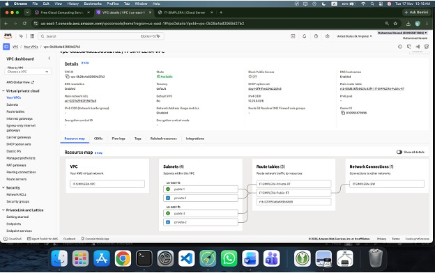

### Subnet layout

Four subnets were created across two Availability Zones to separate public-facing and private workloads.

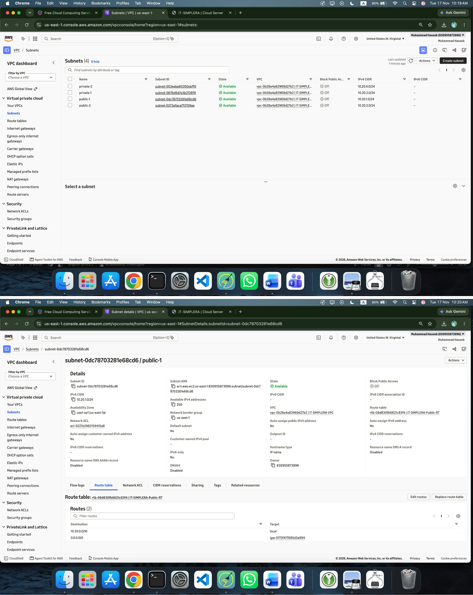

**Public subnet — Availability Zone A**

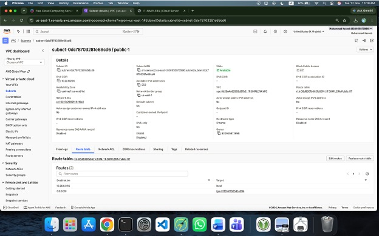

**Private subnet — Availability Zone A**

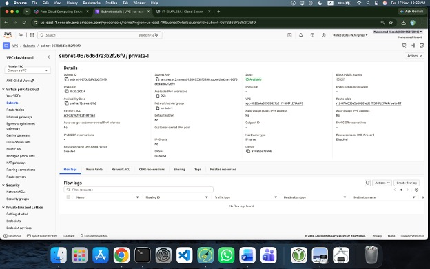

## 3. Internet Gateway and route tables

The Internet Gateway is attached to the VPC. The public route table sends internet-bound IPv4 traffic to the gateway. The private route table has no internet default route.

### Internet Gateway

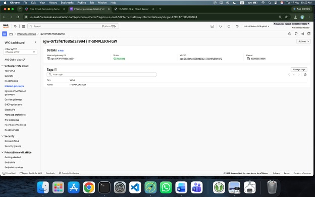

### Public route table

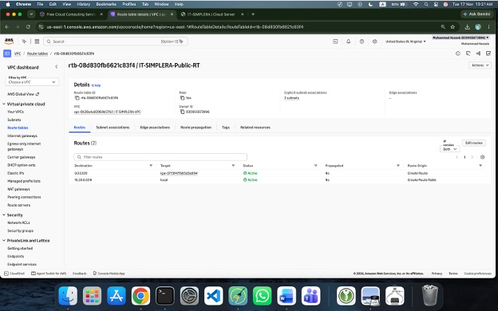

### Private route table

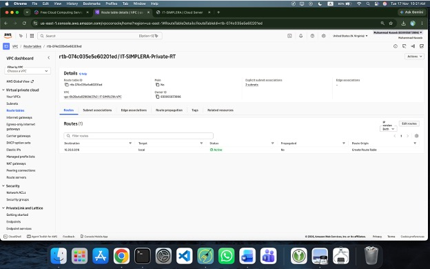

### Subnet associations

The public subnets are associated with the public route table, and the private subnets are associated with the private route table.

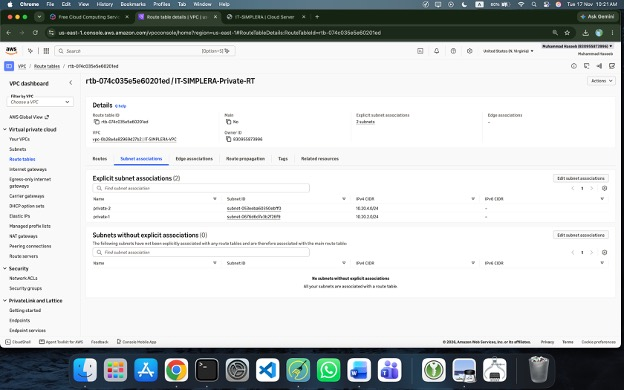

## 4. Security groups

Security groups control traffic at the EC2 network interface. The public security group permits web traffic and restricts SSH to the administrator's public IP address. The private security group permits the intended application/test traffic from the public security group.

### Public security group

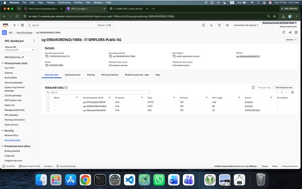

### Private security group

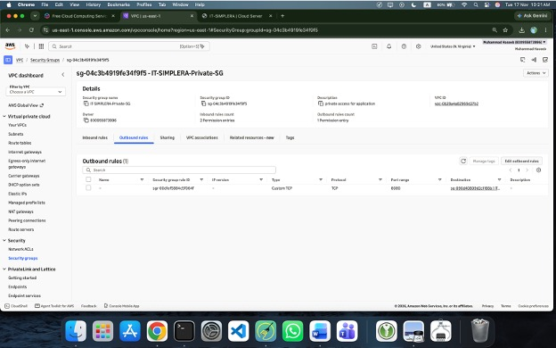

Refer to [the security-group documentation](docs/security-groups.md) for the rule descriptions and security rationale.

## 5. EC2 deployment

Two Ubuntu EC2 instances were deployed in the VPC:

| Instance | Subnet | Private IPv4 | Public IPv4 |
|---|---|---:|---:|
| Public EC2 | Public subnet A | `10.20.1.249` | `100.31.120.30` |
| Private EC2 | Private subnet A | `10.20.2.209` | None |

The public instance hosted an Nginx landing page. The private instance had no public IPv4 address.

### Public EC2 instance details

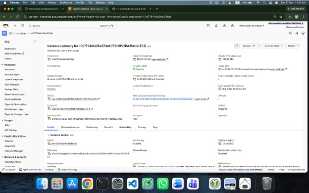

### Private EC2 instance details

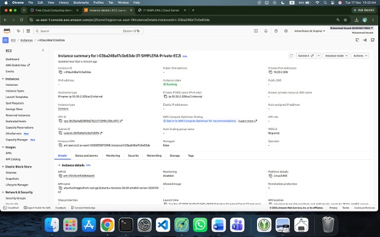

## 6. Connectivity and application tests

The following evidence was captured while the instances were running. These results demonstrate both successful connectivity and intentionally restricted traffic.

### SSH to the public instance

SSH access to the public EC2 instance succeeded using the permitted administrative source.

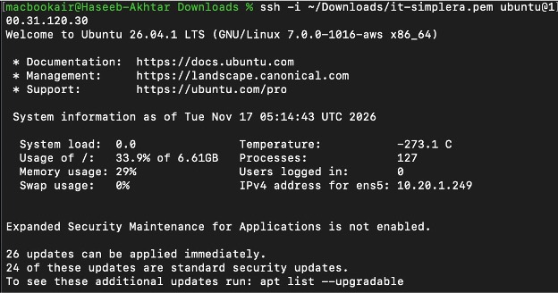

### Nginx web server

The Nginx landing page was reachable through the public instance's public IPv4 address.

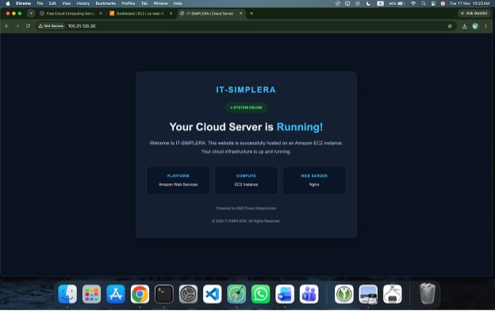

### ICMP connectivity to the private instance

Ping from the public EC2 instance to `10.20.2.209` succeeded, with all four packets received.

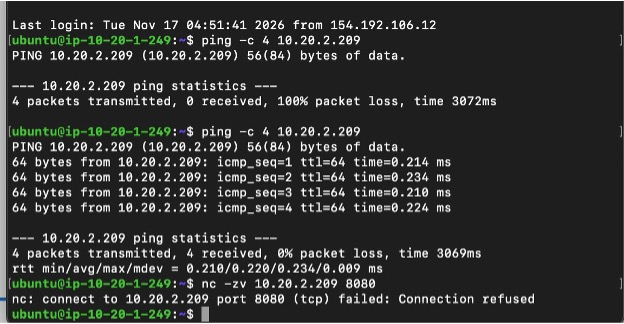

### Interpreting the port tests

The recorded TCP tests have different meanings:

- **TCP 8080 — Connection refused:** the destination host responded, but no application was listening on that port. This is not evidence of a security-group timeout.
- **TCP 80 — Connection timed out:** the connection did not complete, consistent with the private security group not allowing that inbound traffic from the public instance.

See [connectivity test notes](docs/connectivity-tests.md) for the commands and interpretation.

## 7. Internet connectivity validation

The public instance successfully resolved an external DNS name and established outbound HTTPS connectivity. The HTTPS request returned an HTTP success response.

A NAT Gateway was intentionally not created to avoid unnecessary charges. Consequently, the private subnet has no internet egress route in this design.

## 8. Key outcomes

- Designed a custom VPC using a structured CIDR allocation.
- Created four public/private subnets across two Availability Zones.
- Configured and associated separate public and private route tables.
- Attached an Internet Gateway and configured public-subnet internet routing.
- Applied security-group rules to control instance-to-instance traffic.
- Deployed public and private EC2 instances.
- Hosted and verified an Nginx page on the public instance.
- Tested SSH, ICMP, TCP connectivity, DNS resolution, and outbound HTTPS.
- Documented the network design, security rules, test results, and cleanup process.

## 9. Documentation

| Document | Description |
|---|---|
| [Network design](docs/network-design.md) | VPC, CIDR plan, subnets, and routing |
| [Security groups](docs/security-groups.md) | Inbound/outbound rules and rationale |
| [Connectivity tests](docs/connectivity-tests.md) | Test commands, results, and interpretation |
| [Cost and cleanup](docs/cost-and-cleanup.md) | Cost-conscious choices and resource cleanup |
| [Demo guide](docs/demo-guide.md) | Suggested instructor demonstration sequence |
| [Architecture diagram](diagrams/aws-vpc-architecture.svg) | Editable network diagram |
| [Evidence index](evidence/README.md) | Screenshot inventory |

## 10. Evidence and resource status

The screenshots in the `evidence/` directory are implementation-time evidence. They document the configuration and tests as they existed when captured. The AWS resources may subsequently be deleted to prevent ongoing charges; deleting resources does not invalidate the historical screenshots.

**Security note:** Never commit private keys, passwords, access tokens, or other credentials to this repository.
