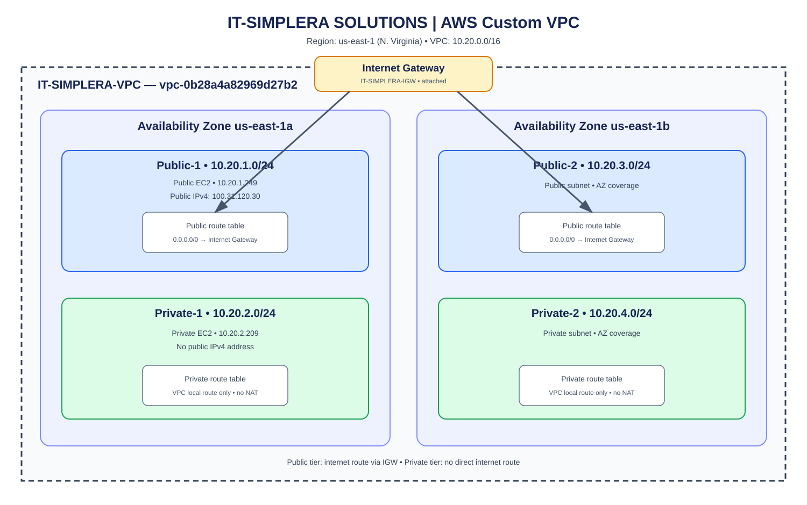

# AWS Custom VPC Network Design

**IT-SIMPLERA SOLUTIONS — Cloud Computing | Week 1 Assignment**

A hands-on AWS networking project that builds and validates a custom VPC with public and private subnets across two Availability Zones. The implementation demonstrates subnet isolation, internet routing, least-privilege security group rules, EC2 connectivity, DNS resolution, and intentionally blocked traffic.

> **Implementation note:** This repository documents the deployed environment and observed tests. A NAT Gateway was not created: it was optional, chargeable, and not required to demonstrate the private subnet's isolation.

## Project objectives

- Design a non-overlapping IPv4 address plan inside a custom VPC.
- Deploy two public and two private subnets across two Availability Zones.
- Route public subnet traffic through an Internet Gateway.
- Keep private subnets on a separate route table with no direct internet route.
- Restrict inbound access using security groups.
- Validate allowed and blocked connectivity with real command output.
- Record the design, evidence, cost considerations, and cleanup guidance.

## Architecture

The editable SVG is in [diagrams/aws-vpc-architecture.svg](diagrams/aws-vpc-architecture.svg). The deployed design uses the VPC local route for communication within the VPC. Public subnets use the public route table; private subnets use the private route table.

## Environment summary

| Item | Deployed configuration |
|---|---|
| AWS Region | US East (N. Virginia), `us-east-1` |
| VPC | `IT-SIMPLERA-VPC` — `10.20.0.0/16` |
| VPC ID | `vpc-0b28a4a82969d27b2` |
| Availability Zones | `us-east-1a`, `us-east-1b` |
| Internet Gateway | `IT-SIMPLERA-IGW` (attached) |
| Public route table | `IT-SIMPLERA-Public-RT` |
| Private route table | `IT-SIMPLERA-Private-RT` |
| Public test host | Ubuntu EC2, Nginx |
| Private test host | Ubuntu EC2, no public IPv4 |

## IP addressing plan

| Subnet | CIDR | AZ | Type |
|---|---|---|---|
| Public-1 | `10.20.1.0/24` | `us-east-1a` | Public |
| Private-1 | `10.20.2.0/24` | `us-east-1a` | Private |
| Public-2 | `10.20.3.0/24` | `us-east-1b` | Public |
| Private-2 | `10.20.4.0/24` | `us-east-1b` | Private |

All four subnet ranges are distinct and fit within `10.20.0.0/16`. See [the network design](docs/network-design.md) for resource IDs and routing details.

## Routing and traffic control

- **Public route table:** VPC-local route plus `0.0.0.0/0 → Internet Gateway`. Associated with Public-1 and Public-2.
- **Private route table:** VPC-local route only. Associated with Private-1 and Private-2. It has no default route to the Internet Gateway or a NAT Gateway.
- **Public security group:** HTTP (80) and HTTPS (443) inbound; SSH (22) restricted to the operator's public IP as a `/32` at configuration time.
- **Private security group:** ICMP and TCP 8080 inbound only from the public security group.

Detailed rules and caveats are in [docs/security-groups.md](docs/security-groups.md).

## Validation results

| Test | Observed result | Interpretation |
|---|---|---|
| SSH from operator workstation to public EC2 | Successful | Public host reachable on TCP 22 from the allowed source |
| Public EC2 → private EC2 ping | 4/4 replies, 0% loss | ICMP allowed by the private security group |
| Public EC2 → private EC2 TCP 80 | Timed out | Expected blocked path; private SG has no TCP 80 ingress rule |
| Public EC2 → private EC2 TCP 8080 | Connection refused | Host was reachable, but no service was listening; this is **not** proof of an SG block |
| Public EC2 DNS lookup | Successful | DNS resolution works from the public instance |
| Public EC2 outbound HTTPS to example.com | HTTP 200 | Public instance has outbound internet connectivity |
| Public web page | Nginx landing page served over HTTP | Application-level public access verified |

Commands, results, and interpretation are recorded in [docs/connectivity-tests.md](docs/connectivity-tests.md).

## Repository contents

- `docs/network-design.md` — VPC, subnet plan, route tables, and routing paths.
- `docs/security-groups.md` — inbound/outbound rules and security rationale.
- `docs/connectivity-tests.md` — commands, observed outcomes, and interpretation.
- `docs/cost-and-cleanup.md` — cost controls and teardown checklist.
- `docs/demo-guide.md` — concise instructor demonstration sequence.
- `diagrams/aws-vpc-architecture.svg` — editable architecture diagram.
- `evidence/` — place original AWS console screenshots and test captures here.

## Evidence checklist

Add the original screenshots captured during implementation to `evidence/` before final submission. Recommended evidence:

1. VPC details showing CIDR and DNS settings.
2. Four subnet details showing CIDRs and Availability Zones.
3. Internet Gateway attached to the VPC.
4. Public and private route table routes and subnet associations.
5. Public and private security group inbound rules (and outbound tabs).
6. Public and private EC2 instance details, including the private host's lack of public IPv4.
7. Nginx landing page, successful ping, DNS/HTTPS test, and blocked TCP 80 test.

Do not upload private keys, access tokens, passwords, or other credentials. Screenshots should not expose secrets.

## Important implementation notes

- The private EC2 instance is in `10.20.2.0/24` and has no public IPv4 address.
- Session Manager was not used because the instance was not registered as a connected managed node during this exercise. The assignment's "where possible" wording was treated as guidance, not a reason to add unplanned infrastructure.
- The private security group's outbound tab was not clearly visible in the evidence reviewed. Verify its actual outbound configuration in the AWS console and capture it before submission; do not infer a setting from an unclear screenshot.
- HTTPS inbound (443) is configured on the public security group, but the demonstrated Nginx page is served over HTTP (80). No HTTPS application endpoint is claimed.
- NAT Gateway was intentionally omitted to avoid optional ongoing charges. Private subnets therefore do not have general outbound internet access through this design.

## Submission

This project is prepared as the technical documentation for the IT-SIMPLERA SOLUTIONS Week 1 assignment. Before sharing with the instructor, add the original evidence screenshots and confirm the private security group's outbound rules against the live AWS console.

---
**Project:** AWS Custom VPC Network Design  
**Region:** `us-east-1`  
**Repository:** [SkyInfra/aws-custom-vpc-network-design](https://github.com/SkyInfra/aws-custom-vpc-network-design)
